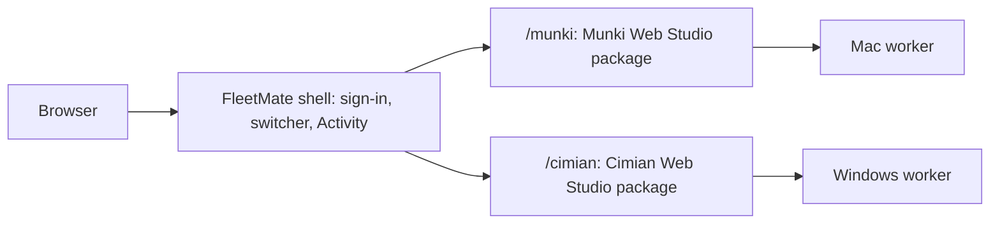

# Architecture: hosting two standalone studios

Status: proposal · 2026-11-04

## Shape

Munki Web Studio and Cimian Web Studio are each a complete app: UI, API,
repository adapter, platform worker, sign-in, and deployment. FleetMate is a
thin host that installs both studios as packages and runs them in one process.

Dependencies point one way: FleetMate to the studios. Each studio defines its
hosting surface in its own `docs/hosting.md` (identical in both): a manifest, an
API router, a UI module, an identity hook, settings, job types, and health.

## What FleetMate owns

| Piece                    | Why it is here, not in a studio                                                       |
| ------------------------ | ------------------------------------------------------------------------------------- |
| Shell and navigation     | Switching between a Mac and a Windows repository only exists when both are present    |
| Sign-in                  | One OIDC session handed to both studios through their identity hook                   |
| Roles                    | Maps one user's roles onto each studio's Viewer/Editor/Publisher/Administrator        |
| Activity and diagnostics | One view over both studios' jobs, workers, and health                                 |
| Deployment               | One image, one ingress, one app-state store holding both studios' state               |
| Drift check              | CI that compares the copied workspace code in the two studios and reports differences |

Anything else belongs in a studio.

## Versions

FleetMate pins one release of each studio. A studio release that changes the
hosting contract version lands in FleetMate only after both studios support it.
FleetMate can ship with an older studio release if the other studio has moved on.

## Brand

Inside FleetMate, each studio keeps its own name, icon, and accent color within
its section, so a Munki admin and a Cimian admin both recognize their tool. The
shell itself uses a neutral FleetMate theme.

## Backend

Both studios use Python, decided 2026-11-04 (see either studio's
`docs/backend.md`). Hosting both in one process requires that they share a
runtime. If they ever diverge, FleetMate would run them as two processes behind
one proxy instead, which keeps the same user experience at higher operating cost.

## Open questions

- In-process hosting or two processes behind a proxy from the start?
- One app-state database with a schema per studio, or one database per studio?
