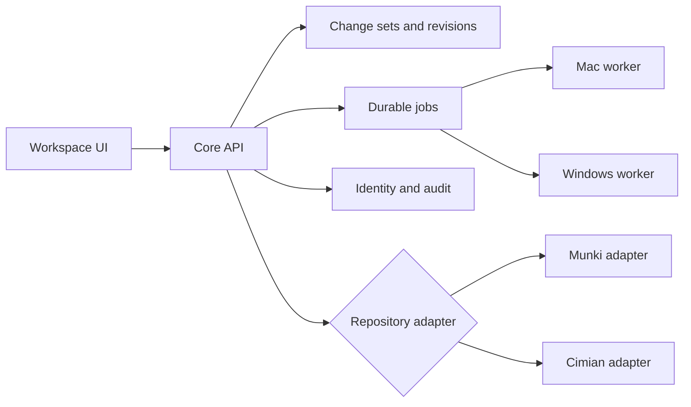

# Architecture: one core, two adapters

Status: proposal · 2026-10-20

## Why one core

Munki and Cimian model software the same way: pkginfo describes a package,
manifests assign packages to machines, catalogs are generated from pkginfo, and
an admin edits, reviews, and publishes. The web layer has no reason to differ.
What differs is narrow and well bounded:

| Concern         | Munki                                                         | Cimian                                                 |
| --------------- | ------------------------------------------------------------- | ------------------------------------------------------ |
| Metadata format | XML or binary plist; YAML in recent versions                  | YAML                                                   |
| Typed values    | Dates, data, integers, booleans                               | YAML scalars; version strings must stay strings        |
| Conditions      | `NSPredicate` strings                                         | Cimian expression strings and fact/operator/value maps |
| Installer types | pkg, dmg, copy_from_dmg, profile                              | msi, exe, msix, nupkg, ps1                             |
| Tool host       | macOS (`makecatalogs`, installer inspection, icon extraction) | Windows (`makecatalogs`, `cimiimport`, `cimipkg`)      |
| Typical serving | Web server or object storage                                  | Azure Blob, S3, or web server                          |

Everything else, including the workspace, drafts, conflicts, review, jobs, Git,
auth, and audit, is shared.

## Shape

## The adapter contract

A repository adapter is the only code that reads or writes repository files. It
provides:

- **Layout**: which directories exist and how a relative path maps to an object
  kind (package, manifest, catalog, icon, payload).
- **Codec**: parse bytes into a typed document and back, preserving unknown keys,
  ordering, and formatting. A no-op round trip must return identical bytes.
- **Schema**: the known fields for each object kind, their types, and which ones
  the structured editor shows, grouped into editor tabs.
- **References**: how manifests point at packages and other manifests, so the core
  can build the dependency graph and flag missing items.
- **Conditions**: parse condition expressions for display and validation; the
  core renders them as rules.
- **Capabilities**: the jobs this platform supports and the worker each one needs.

The core owns identity (repository ID plus relative path), revisions derived from
raw bytes, the write coordinator, and the journal. It passes typed documents
between the UI and the adapter without interpreting format details.

## Workers

One job contract, two worker builds. A Mac worker runs Munki tools; a Windows
worker runs Cimian tools. Each reports its capabilities and tool versions in a
handshake. The UI shows a job as unavailable, with the reason, when no worker
for it is connected.

## How the three repositories ship

- **fleetmate-web-admin** publishes the core as packages (UI shell, API, contracts)
  and a combined app that loads both adapters, for admins who run both platforms.
- **munki-web-studio** depends on the core, adds the Munki adapter and Mac worker,
  and ships a Munki-only build with Munki branding.
- **cimian-web-studio** does the same for Cimian with the Windows worker.

Each studio is a thin distribution. If a studio needs a change in shared
behavior, the change goes into the core, not into a studio fork of it.

## Stack

React, TypeScript, and Vite for the browser, as already proposed. The backend
choice now has to suit both codecs: Python handles plist natively and YAML with
`ruamel.yaml`; .NET could reuse Cimian's models but has weaker plist support;
TypeScript shares a language with the UI but needs both codecs proven. Decide in
one spike that round-trips both studios' fixture sets through each candidate.

## Open questions

- One deployment serving both repo types, or separate deployments per studio?
- Do adapters run in the core process, or as separate services the core calls?
- Package distribution for the core: a private registry, Git dependencies, or
  a monorepo with the studios as thin wrappers?
